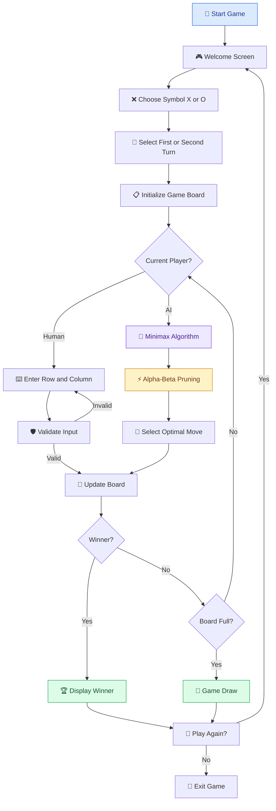
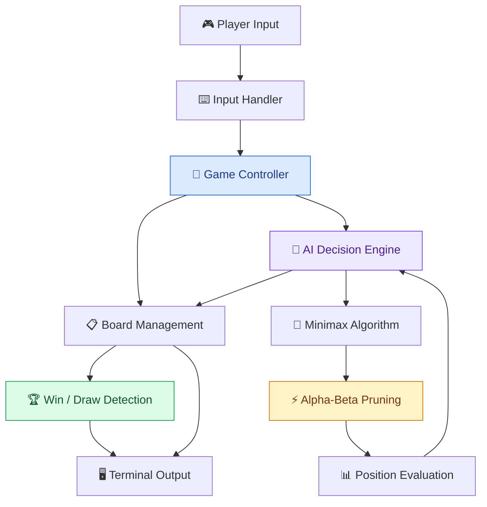

# 🎮 Tic-Tac-Toe AI
### Unbeatable Artificial Intelligence Using Minimax & Alpha-Beta Pruning

<p align="center">
  <b>Challenge an intelligent AI opponent in a classic Tic-Tac-Toe game powered by Artificial Intelligence.</b>
</p>

<p align="center">
  
  
  
  
  
</p>

---

## 🌟 Overview

**Tic-Tac-Toe AI** is a Python-based command-line game that allows users to play the classic Tic-Tac-Toe game against an intelligent computer opponent.

Unlike a traditional computer opponent that selects random moves, this project uses the **Minimax algorithm with Alpha-Beta Pruning** to analyze possible game outcomes and select the most optimal move.

The AI evaluates possible future game states, considers the opponent's best responses, and makes strategic decisions to avoid losing.

The result is an unbeatable AI opponent: if both players play optimally, the game will always end in a draw.

### 🎯 Project Objectives

- Implement an intelligent game-playing AI.
- Understand adversarial search algorithms.
- Apply Minimax for optimal decision-making.
- Improve search efficiency using Alpha-Beta Pruning.
- Explore recursive algorithms and game-state evaluation.
- Develop an interactive command-line gaming experience.

## ✨ Key Features

| Feature | Description |
|---|---|
| 🎮 Interactive Gameplay | Play Tic-Tac-Toe directly in the terminal. |
| 🤖 Intelligent AI Opponent | Computer selects optimal moves using Minimax. |
| 🧠 Alpha-Beta Pruning | Eliminates unnecessary search branches. |
| ⚡ Depth-Aware Scoring | AI prefers faster wins and delays unavoidable losses. |
| ❌ Symbol Selection | Choose either X or O. |
| 🔄 First-Move Selection | Decide whether to play first or second. |
| 🛡️ Input Validation | Handles invalid, occupied, and out-of-range positions. |
| 🏆 Win Detection | Automatically identifies winning combinations. |
| 🤝 Draw Detection | Detects when the board is full without a winner. |
| 🔁 Replay Option | Start another match without restarting the program. |
| 📦 Zero Dependencies | Uses only Python's standard library. |

## 🖥️ Game Preview

The game uses a traditional 3 × 3 Tic-Tac-Toe board.

```text
       TIC-TAC-TOE AI
   ---------------------

       0   1   2
     +---+---+---+
   0 | X | O |   |
     +---+---+---+
   1 |   | X |   |
     +---+---+---+
   2 | O |   | X |
     +---+---+---+

       Winner: X
```

*Illustrative game-board preview.*

## 🔄 How It Works — Game Workflow

The application follows a structured gameplay process, from player configuration to the final result.



## 🏗️ System Architecture

The application follows a simple modular architecture in which the game engine, user interaction, board management, and AI decision-making work together.



### Core Components

| Component | Responsibility |
|---|---|
| Game Controller | Controls the complete gameplay sequence. |
| Board Management | Maintains the current 3 × 3 board state. |
| Input Handler | Reads and validates human moves. |
| AI Decision Engine | Determines the computer's optimal move. |
| Minimax Algorithm | Evaluates possible future game states. |
| Alpha-Beta Pruning | Reduces unnecessary recursive searches. |
| Win Detection | Checks winning combinations. |
| Draw Detection | Identifies completed boards without winners. |

## 🧠 Artificial Intelligence Algorithm

The intelligence behind this project comes from the **Minimax algorithm combined with Alpha-Beta Pruning**.

### 1. Minimax Algorithm

Minimax is a recursive decision-making algorithm commonly used in two-player adversarial games.

It assumes that both players make optimal decisions.

- **Maximizing Player:** The AI attempts to maximize its score.
- **Minimizing Player:** The human opponent attempts to minimize the AI's score.

The algorithm explores possible moves and evaluates their resulting game states to identify the best move.

### 2. Alpha-Beta Pruning

Alpha-Beta Pruning improves Minimax by eliminating branches that cannot influence the final decision.

It maintains two values:

- **Alpha (α):** Best score currently guaranteed to the maximizing player.
- **Beta (β):** Best score currently guaranteed to the minimizing player.

When:

\[
\alpha \geq \beta
\]

The remaining branches can be skipped because they cannot improve the decision.

This reduces unnecessary computation without changing the optimal result.

### 3. Depth-Aware Scoring

The AI uses depth-aware evaluation to prefer quicker victories and delay unavoidable defeats.

| Game Outcome | Evaluation Score |
|---|---|
| AI Wins | `10 - depth` |
| Human Wins | `depth - 10` |
| Draw | `0` |

**Example:**

- Winning at depth 2 produces a score of 8.
- Winning at depth 5 produces a score of 5.
- Losing at depth 2 produces a score of -8.
- Losing at depth 5 produces a score of -5.

Therefore, the AI prefers faster wins and delays losses whenever possible.

### 4. Why Is the AI Unbeatable?

The AI evaluates possible future game states and assumes the human player will also make the best possible decisions.

Because every relevant game outcome is considered, the AI cannot be forced into a losing position when the algorithm is implemented correctly.

**Best possible result against optimal AI: Draw.**

## 📊 Algorithm Complexity

For a 3 × 3 Tic-Tac-Toe board:

| Parameter | Complexity |
|---|---|
| Maximum Board Positions | 9 |
| Minimax Time Complexity | O(bᵈ) |
| Minimax Space Complexity | O(d) with depth-first recursion |
| Alpha-Beta Best Case | O(b^(d/2)) |
| Alpha-Beta Worst Case | O(bᵈ) |

Where:

- `b` = branching factor.
- `d` = search depth.

Alpha-Beta Pruning can significantly reduce the number of evaluated positions, especially when promising moves are examined early.

## 📁 Project Structure

```text
Tic-Tac-Toe-AI/
│
├── tictactoe.py       # Complete game implementation
│                      # Board management
│                      # Minimax algorithm
│                      # Alpha-Beta pruning
│                      # Input validation
│                      # Gameplay controller
│
└── README.md          # Project documentation
```

The project is intentionally lightweight, with the game logic and AI implementation contained in a single Python file.

## ⚙️ Requirements

Before running the application, ensure that you have:

- Python 3.6 or higher.
- A terminal or command-line interface.
- Any code editor (VS Code recommended).

**External Dependencies:** None.

The application uses Python's built-in standard library.

## 🚀 Installation & Execution

### Step 1: Clone the Repository

```bash
git clone https://github.com/<your-username>/Tic-Tac-Toe-AI.git
```

### Step 2: Navigate to the Project Directory

```bash
cd Tic-Tac-Toe-AI
```

### Step 3: Run the Application

```bash
python tictactoe.py
```

If your system uses `python3`, execute:

```bash
python3 tictactoe.py
```

### Step 4: Start Playing!

Follow the terminal instructions to select your symbol and begin the game.

## 🎮 How to Play

### Step 1: Choose Your Symbol

```text
Welcome to Tic-Tac-Toe!
Choose your symbol (X/O): O
```

### Step 2: Select Your Turn

```text
Do you want to go first? (y/n): y
```

### Step 3: Enter Your Move

Enter the row and column coordinates separated by a space or comma.

```text
Enter your move (row and column, 0-2, e.g. '1 1'): 1 1
```

### Board Coordinates

```text
        Column
       0   1   2
     +---+---+---+
  0  |   |   |   |
     +---+---+---+
  1  |   |   |   |
     +---+---+---+
  2  |   |   |   |
     +---+---+---+

       Row
```

**Important:** Indexing starts from 0.

### Step 4: AI Makes Its Move

```text
AI is thinking...
AI plays at (0, 0)
```

The AI evaluates available moves and selects the optimal position.

### Step 5: Complete the Game

The game continues until:

- The human player wins.
- The AI wins.
- The board becomes full, resulting in a draw.

After the match, the player can choose whether to play again.

## 💻 Example Gameplay Session

```text
Welcome to Tic-Tac-Toe!

Choose your symbol (X/O): O
Do you want to go first? (y/n): y

   |   |
---+---+---
   |   |
---+---+---

Enter your move (row and column, 0-2, e.g. '1 1'): 1 1

   |   |
---+---+---
   | O |
---+---+---

AI is thinking...
AI plays at (0, 0)

   X |   |
  ---+---+---
     | O |
  ---+---+---

Enter your move (row and column, 0-2, e.g. '1 1'):
```

*Illustrative gameplay output; actual moves depend on the current board state.*

## 🧩 Code Structure & Functions

| Function | Responsibility |
|---|---|
| `print_board(board)` | Displays the current game board. |
| `check_winner(board, player)` | Checks whether a player has three consecutive symbols. |
| `check_draw(board)` | Determines whether the board is full. |
| `available_moves(board)` | Returns all available empty positions. |
| `minimax(...)` | Recursively evaluates possible game outcomes using Alpha-Beta Pruning. |
| `best_move(board, ai, human)` | Determines the AI's optimal move. |
| `get_human_move(board)` | Reads and validates human input. |
| `ask_choice(prompt, options)` | Provides reusable input validation. |
| `play_game()` | Runs an individual game. |
| `main()` | Handles the replay loop and program execution. |

## 🛡️ Input Validation & Error Handling

The game includes validation to maintain a smooth gameplay experience.

| Invalid Input | Expected Handling |
|---|---|
| Alphabetic characters instead of coordinates | Reject invalid input |
| Coordinates outside 0–2 | Ask the player again |
| Already occupied cell | Reject the move |
| Incorrect coordinate format | Display an error message |
| Invalid symbol selection | Request X or O again |
| Invalid first-turn selection | Request a valid yes/no response |

The application also supports clean termination using `Ctrl+C`.

## 🏆 What Makes This Project Interesting?

This project demonstrates several important concepts in Artificial Intelligence and Computer Science:

- Adversarial Search.
- Recursive Problem Solving.
- Game Theory Fundamentals.
- Minimax Decision-Making.
- Alpha-Beta Pruning.
- Tree-Based Search.
- Algorithm Optimization.
- Input Validation.
- Modular Python Programming.

It provides a practical demonstration of how AI can make strategic decisions instead of relying on random choices.

## 🔭 Future Enhancements

The following features can make the project more advanced:

- [ ] **Difficulty Levels:** Introduce Easy, Medium, and Hard modes.
- [ ] **Random AI Mode:** Allow occasional non-optimal moves for easier gameplay.
- [ ] **Graphical User Interface:** Build a GUI using Tkinter or Pygame.
- [ ] **Scoreboard:** Track human wins, AI wins, and draws.
- [ ] **Game Statistics:** Record the number of matches played.
- [ ] **Move History:** Display previous moves.
- [ ] **Undo Functionality:** Allow users to undo their last move.
- [ ] **Sound Effects:** Add audio feedback for moves and wins.
- [ ] **Two-Player Mode:** Allow two humans to play against each other.
- [ ] **Web-Based Version:** Convert the game into an interactive browser application.

## 📚 Learning Outcomes

By developing this project, you can gain practical experience with:

1. Implementing Artificial Intelligence algorithms in Python.
2. Understanding Minimax and adversarial search.
3. Optimizing recursive algorithms using Alpha-Beta Pruning.
4. Working with multidimensional game boards.
5. Designing game-state evaluation functions.
6. Managing user input and application flow.
7. Understanding decision trees and optimal strategies.

## 👨‍💻 Developer

<p align="center">
  <b>Lakshya Kansal</b>
  <br/>
  Python | Artificial Intelligence | Algorithm Development
  <br/><br/>
  <a href="https://github.com/lakshyakansal">
    GitHub
  </a>
</p>

---

<p align="center">
  ⭐ If you enjoyed this project, consider giving the repository a star!
  <br/><br/>
  <b>Think strategically. Play intelligently. Never lose.</b>
  <br/>
  <i>Tic-Tac-Toe AI — Powered by Minimax & Alpha-Beta Pruning.</i>
</p>
